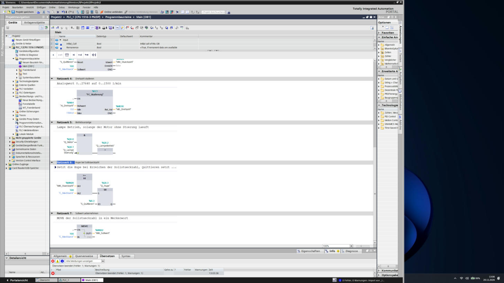

<div align="center">

# 🏭 TIA-mcp

**Siemens TIA Portal als Werkzeug für KI-Assistenten (Claude, Copilot …)**

MCP-Server auf Basis von TIA Portal Openness: Projekt lesen, Bausteine in SCL/KOP/FUP schreiben, übersetzen,
exportieren und importieren, direkt aus dem Chat.


</div>

---

## Inhalt

- [Was ist das?](#was-ist-das)
- [Was kann er?](#was-kann-er)
- [Installation auf einem neuen System](#installation-auf-einem-neuen-system)
- [Benutzung](#benutzung)
- [Konfiguration](#konfiguration)
- [Fehlerbehebung](#fehlerbehebung)
- [Entwicklung](#entwicklung)
- [Herkunft und Lizenz](#herkunft-und-lizenz)

---

## Was ist das?

Ein [Model Context Protocol](https://modelcontextprotocol.io)-Server (stdio), der sich über **TIA Portal Openness**
an ein laufendes TIA Portal hängt. Ein KI-Assistent bekommt damit rund **120 Werkzeuge**, um das gerade geöffnete
Projekt zu lesen und zu bearbeiten.

```
┌──────────────┐   MCP (stdio)   ┌──────────────────┐   Openness   ┌──────────────────┐
│ Claude Code  │ ◄─────────────► │ TiaMcpServer.exe │ ◄──────────► │ TIA Portal V20   │
│ Claude App   │                 │  (.NET 4.8, x64) │              │ (offenes Projekt)│
│ VS Code      │                 └────────┬─────────┘              └──────────────────┘
└──────────────┘                          │ Export / Import
                                          ▼
                                 Export-Ordner (XML, SCL, AWL, DB, UDT)
```

Dieser Stand ist ein Fork von [heilingbrunner/tiaportal-mcp](https://github.com/heilingbrunner/tiaportal-mcp) (v0.4.0),
**für TIA Portal V20 neu gebaut** und um viele Korrekturen erweitert (die ausgelieferte Extension läuft nur mit V21).
Was geändert wurde, steht in [CHANGELOG-V20.md](CHANGELOG-V20.md).

<p align="center">
  
  <br><sub>OB1 „Main“ in FUP, komplett vom Assistenten als SimaticML erzeugt und über <code>WriteBlockSource</code> importiert.</sub>
</p>

---

## Was kann er?

| Bereich | Beispiele | Wichtige Tools |
| --- | --- | --- |
| 🔌 **Verbinden** | an laufendes TIA hängen, Instanz wählen, Umgebung prüfen | `TiaConnect`, `GetPortals`, `GetState`, `Doctor` |
| 🌳 **Projekt erkunden** | Projektbaum, Geräte, PLC-Übersicht | `GetProjectTree`, `GetSoftwareTree`, `GetDevices`, `GetPlcSummary` |
| 🧱 **Bausteine lesen** | Liste, Schnittstelle (DB/FB/FC/OB), Quelltext, SimaticML | `GetBlocks`, `GetBlockInterface`, `GetSourceBlock`, `GetXmlBlock` |
| ✍️ **Bausteine schreiben** | SCL/AWL/DB/UDT als Quelle, **KOP/FUP als XML**, mit Übersetzen und Compiler-Meldungen | `WriteBlockSource`, `CreateFB`, `CreateInstanceDB` |
| 🗂️ **Bausteine verwalten** | kopieren, verschieben, umbenennen, löschen, Gruppen | `CopyBlock`, `MoveBlock`, `RenameBlock`, `DeleteBlock`, `CreateBlockGroup` |
| 🏷️ **Variablen** | Variablentabellen, Tags mit Kommentar, Konstanten | `GetTags`, `CreateTag`, `UpdateTag`, `CreateUserConstant` |
| 👀 **Beobachten** | Beobachtungs- und Forcetabellen | `GetWatchTables`, `CreateWatchTable`, `ImportWatchTable` |
| 📐 **Datentypen** | UDTs lesen, kopieren, verschieben | `GetTypes`, `GetTypeInfo`, `CopyType`, `MoveType` |
| 🔍 **Suchen** | Volltext in SCL/KOP/FUP (mit Netzwerk), Verwendungsstellen, Querverweise | `FindInCode`, `WhereUsed`, `GetCrossReferences` |
| ⚙️ **Übersetzen** | ganze PLC oder einzelner Baustein, Report als Tabelle | `CompilePlcSoftware`, `CompileCodeBlock` |
| 📦 **Export/Import** | Programm, Bausteine, Tags, Hardware (AML), OPC UA | `ExportPlcProgram`, `TiaPull*`, `TiaPush*`, `PreviewImport` |
| 💾 **Projekt** | speichern (nur auf Wunsch), speichern unter, schließen | `SaveProject`, `SaveAsProject`, `CloseProject` |

**Sicherheitsnetz**

- **Nur lesen**, solange der Server nicht mit `--allow-write` startet. Ohne den Schalter sind die verändernden
  Tools gar nicht registriert.
- Jede Änderung läuft in einer **TIA-Transaktion** und wird bei einem Fehler komplett zurückgerollt.
- Änderungen liegen nur **im Speicher**, bis jemand `SaveProject` aufruft.
- `WriteBlockSource`/`TiaPush` fragen einmal pro Sitzung per Dialog nach („Yes, import“).
- TIA selbst fragt bei jedem neuen Server-Prozess nach dem **Openness-Zugriff**.

Die vollständige englische Tool-Referenz des Upstream-Projekts liegt in [docs/REFERENCE.md](docs/REFERENCE.md), die
Arbeitsanleitung für Agenten (Abläufe, FUP-Rezept, Stolperfallen) in [docs/ANLEITUNG.md](docs/ANLEITUNG.md).

---

## Installation auf einem neuen System

### 1. Voraussetzungen

| | Was | Prüfen |
| --- | --- | --- |
| ✅ | Windows 10/11 x64 | |
| ✅ | **TIA Portal V20** mit Openness (wird bei der TIA-Installation mit installiert) | `C:\Program Files\Siemens\Automation\Portal V20\PublicAPI\V20\Siemens.Engineering.dll` existiert |
| ✅ | Benutzer in der lokalen Gruppe **„Siemens TIA Openness“** | `whoami /groups \| findstr Openness` |
| ✅ | .NET Framework 4.8 (Laufzeit) | bei Windows 10/11 vorhanden |
| ✅ | **.NET SDK** 8 oder neuer (nur zum Bauen) | `dotnet --version` |
| ✅ | Git | `git --version` |
| ➕ | ein MCP-Client: Claude Code, Claude Desktop oder VS Code | |

> **Gruppe „Siemens TIA Openness“:** Ein Administrator fügt den Benutzer hinzu (*Computerverwaltung → Lokale
> Benutzer und Gruppen → Gruppen*), danach **ab- und wieder anmelden**. Der Server ändert die Gruppe nicht selbst.

### 2. Schnellinstallation (empfohlen)

```powershell
git clone https://github.com/schwarzemax-debug/TIA-mcp.git
cd TIA-mcp
.\tools\Install-TiaMcp.ps1 -RegisterClaudeCode
```

Das Skript

1. prüft TIA-Openness-DLL, .NET SDK und die Openness-Gruppe,
2. baut den Server nach `%USERPROFILE%\TiaMcp\server`,
3. legt den Export-Ordner `%USERPROFILE%\TiaMcp\Project` mit einer `tia.json` an,
4. startet `TiaMcpServer.exe --doctor` als Selbsttest,
5. meldet den Server mit `-RegisterClaudeCode` in Claude Code an (Scope *user*, Name `vscode-tiaportal-mcp`),
6. gibt den JSON-Eintrag für andere Clients aus.

| Parameter | Standard | Bedeutung |
| --- | --- | --- |
| `-TiaVersion` | `20` | TIA-Hauptversion (Build und `--tia-major-version`) |
| `-InstallDir` | `%USERPROFILE%\TiaMcp` | Zielordner für `server\` und `Project\` |
| `-SoftwarePath` | `PLC_1` | Name der PLC im Projekt (Preset für alle Tools) |
| `-ReadOnly` | aus | ohne `--allow-write` installieren |
| `-RegisterClaudeCode` | aus | `claude mcp add` ausführen |

> Bei einem Update muss Claude geschlossen sein (oder `Kill-TiaMcpServers.bat` laufen), sonst ist die EXE gesperrt.

### 3. Manuelle Installation

```powershell
dotnet build src\TiaMcpServer\TiaMcpServer.csproj -c Release -o "$env:USERPROFILE\TiaMcp\server"
mkdir "$env:USERPROFILE\TiaMcp\Project"; copy samples\tia.json "$env:USERPROFILE\TiaMcp\Project\"
& "$env:USERPROFILE\TiaMcp\server\TiaMcpServer.exe" --tia-major-version 20 --doctor
```

Andere TIA-Version: `-p:TiaVersion=19` an `dotnet build` anhängen (getestet ist nur V20, für V21 die
[Upstream-Extension](https://github.com/heilingbrunner/tiaportal-mcp) verwenden).

### 4. Im MCP-Client eintragen

<details open>
<summary><b>Claude Code</b></summary>

```powershell
claude mcp add -s user vscode-tiaportal-mcp -- "$env:USERPROFILE\TiaMcp\server\TiaMcpServer.exe" `
  --tia-major-version 20 --software-path PLC_1 --export-path "$env:USERPROFILE\TiaMcp\Project" `
  --keep-structure --allow-write
```

Alternativ als Projekt-Config: [samples/claude-code/.mcp.json](samples/claude-code/.mcp.json). Danach in Claude Code
mit `/mcp` prüfen, ob `vscode-tiaportal-mcp` verbunden ist.

</details>

<details>
<summary><b>Claude Desktop</b></summary>

`%APPDATA%\Claude\claude_desktop_config.json` (bzw. *Einstellungen → Entwickler → Konfiguration bearbeiten*):

```json
{
  "mcpServers": {
    "vscode-tiaportal-mcp": {
      "command": "C:\\Users\\<NAME>\\TiaMcp\\server\\TiaMcpServer.exe",
      "args": [
        "--tia-major-version", "20",
        "--software-path", "PLC_1",
        "--export-path", "C:\\Users\\<NAME>\\TiaMcp\\Project",
        "--keep-structure",
        "--allow-write"
      ]
    }
  }
}
```

Claude Desktop danach komplett beenden und neu starten.

</details>

<details>
<summary><b>VS Code / GitHub Copilot</b></summary>

Siehe [samples/vscode/mcp.json](samples/vscode/mcp.json) (`.vscode/mcp.json` im Arbeitsordner oder Benutzer-Config).

</details>

### 5. Agent-Anleitung hinterlegen (optional, empfohlen)

Damit der Assistent die Eigenheiten kennt (Ablauf, FUP-Rezept, „nie selbst speichern“), in der globalen
`%USERPROFILE%\.claude\CLAUDE.md` z. B. eintragen:

```markdown
# TIA Portal (MCP-Server `vscode-tiaportal-mcp`)
Bevor du TIA-Portal-Tools benutzt, lies <Pfad zum Repo>\docs\ANLEITUNG.md.
Nie selbst `SaveProject` aufrufen, nur auf ausdrücklichen Wunsch.
```

---

## Benutzung

1. **TIA Portal V20 starten und das Projekt öffnen.** Der Server arbeitet immer mit dem gerade offenen Projekt.
2. Im Chat einfach loslegen, z. B. *„Verbinde dich mit TIA“*. Der Assistent ruft `TiaConnect` auf.
3. **Beim ersten Zugriff fragt TIA „Openness-Zugriff erlauben?“.** Der Dialog liegt oft *hinter* dem TIA-Fenster.
   Mit „Ja“ bestätigen; danach läuft der Aufruf weiter (bei Zeitüberschreitung einfach wiederholen).
4. Arbeiten, prüfen, und erst wenn alles passt: *„Speichere das Projekt“*.

### Beispiel-Prompts

```text
Zeig mir die Bausteinstruktur von PLC_1.
Welche Bausteine verwenden "M_Freigabe" und in welchem Netzwerk?
Erklär mir FB_Motor und zeig die Schnittstelle.
Schreib einen SCL-FB "FB_Ventil" mit Auf/Zu-Rückmeldung, Laufzeitüberwachung und Störausgang.
Erzeuge eine Variablentabelle "IO_Station2" mit diesen Eingängen: …
Baue OB1 in FUP: Netzwerk 1 Freigabe aus Not-Halt UND Motorschutz, Netzwerk 2 Aufruf FB_Motor …
Übersetze die PLC-Software und zeig mir alle Fehler.
Kopiere FC_Skalierung als FC_Skalierung_Druck.
Exportiere alle Bausteine in den Export-Ordner.
```

### Kurzbefehle („Porcelain“)

| Im Chat | Wirkung |
| --- | --- |
| `tia connect` | an TIA hängen, PLC-Pfade ermitteln |
| `tia pull` / `tia pull blocks FB_.*` | Programm bzw. Auswahl in den Export-Ordner schreiben |
| `tia pull tagtables`, `tia pull hardware` | Variablentabellen bzw. Hardware (AML) exportieren |
| `tia push preview` / `tia push` | geänderte Dateien zurück ins Projekt (braucht Git im PATH) |

---

## Konfiguration

| Argument | Bedeutung |
| --- | --- |
| `--tia-major-version <n>` | TIA-Hauptversion, hier **`20`** (Standard wäre 21) |
| `--software-path <pfad>` | feste PLC für alle Tools, z. B. `PLC_1` (bei mehreren PLCs weglassen) |
| `--export-path <ordner>` | Basisordner für Export und Import (enthält `tia.json`) |
| `--keep-structure` | Gruppenstruktur des Projekts im Export-Ordner nachbilden |
| `--allow-write` | verändernde Tools freischalten (ohne: nur lesen) |
| `--trust-writes` | Import ohne Bestätigungsdialog, nur für Clients ohne Dialog-Unterstützung |
| `--project-path <datei>` | Rückfall-Projekt, falls in TIA keines offen ist |
| `--with-dependencies` | `GetSourceBlock`/`GetSourceType` liefern Abhängigkeiten mit |
| `--logging <1\|2\|3>` | 1 = stderr, 2 = Debug-Ausgabe, 3 = Windows-Ereignisanzeige |
| `--doctor` | Umgebungsbericht ausgeben und beenden |

Gesetzte Presets (`--software-path`, `--export-path`, …) sind **bindend**: Das Modell kann sie nicht überschreiben
und schreibt so nie in fremde Ordner. `GetState` zeigt die aktiven Werte.

**`tia.json`** im Export-Ordner legt die Dateiformate fest (z. B. SCL als `.scl`, KOP/FUP als `.xml`); Vorlage in
[samples/tia.json](samples/tia.json), anlegen auch per `tia init`.

---

## Fehlerbehebung

| Symptom | Ursache / Lösung |
| --- | --- |
| `TiaConnect` hängt | Openness-Dialog wartet in TIA, oft **hinter** dem Hauptfenster → „Ja“ klicken |
| MCP „Connection closed“ beim Start | `--doctor` ausführen. Häufig: Benutzer nicht in „Siemens TIA Openness“, oder *Smart App Control* blockiert die unsignierte EXE (Ereignisanzeige → CodeIntegrity, ID 3077) |
| `User is not in the required group …` | Benutzer zur Gruppe hinzufügen, **ab- und anmelden** |
| Build: `Siemens.Engineering` nicht gefunden | TIA-Version/Pfad passt nicht → `-p:TiaVersion=…` bzw. `-p:TiaPortalDir=…` |
| `Block not found` | voller Pfad nötig (`Gruppe/Untergruppe/Name`); `GetBlocks` zeigt ihn |
| Export schlägt fehl | Baustein inkonsistent → erst `CompilePlcSoftware` |
| `The connection with the name 'en' is not connected` | offener Pin im FUP-XML; `WriteBlockSource` ergänzt `<OpenCon>` meist selbst |
| `ImportPlcProgramChanges`/`tia push` scheitert | braucht Git im PATH; alternativ `WriteBlockSource` oder `OverwritePlcProgram` |
| Update: Datei gesperrt | laufender Server hält die EXE → Claude schließen oder `Kill-TiaMcpServers.bat` |

Mehr in [docs/ANLEITUNG.md](docs/ANLEITUNG.md#6-typische-fehler).

---

## Entwicklung

```
TIA-mcp/
├─ src/TiaMcpServer/          Server (C#, .NET Framework 4.8, x64)
│  ├─ ModelContextProtocol/   MCP-Tools, Prompts, Antworttypen
│  └─ Siemens/                Openness-Zugriff (Portal.*.cs)
├─ tests/TiaMcpServer.Test/   MSTest (Unit- und TIA-Integrationstests)
├─ tools/                     Installationsskript, Test-Clients, FUP-Generator
├─ samples/                   Client-Konfigurationen, tia.json
└─ docs/                      Anleitung, Referenz, Bilder
```

```powershell
dotnet build -c Release

# Unit-Tests ohne TIA-Verbindung (die Integrationstests ausgenommen)
$skip = 'Test1Portal','Test2ProjectSession','Test21Project','Test3Devices','Test4Software','Test5McpServer'
dotnet test --filter (($skip | ForEach-Object { "FullyQualifiedName!~$_" }) -join '&')
```

Die ausgenommenen Integrationstests öffnen und schließen Projekte in einer laufenden TIA-Instanz und erwarten
Testprojekte auf dem Rechner. Nur bewusst ausführen.

**Ohne Claude testen:** `tools/mcp-session.ps1` startet den Server einmal (ein TIA-Dialog), `tools/mcp-call.ps1`
schickt beliebig viele Tool-Aufrufe hinein:

```powershell
Start-Job { & "$using:PWD\tools\mcp-session.ps1" -ConfigPath "$using:PWD\samples\claude-code\.mcp.json" -QueueDir C:\Temp\mcpq }
.\tools\mcp-call.ps1 -QueueDir C:\Temp\mcpq -Tool TiaConnect      # in TIA „Ja“ klicken
.\tools\mcp-call.ps1 -QueueDir C:\Temp\mcpq -Tool GetSoftwareTree
.\tools\mcp-call.ps1 -QueueDir C:\Temp\mcpq -Stop
```

---

## Herkunft und Lizenz

- Basis: [heilingbrunner/tiaportal-mcp](https://github.com/heilingbrunner/tiaportal-mcp) von J. Heilingbrunner, MIT-Lizenz
  ([LICENSE.txt](LICENSE.txt)). Upstream-Historie: [CHANGELOG.md](CHANGELOG.md).
- V20-Anpassungen dieses Forks: [CHANGELOG-V20.md](CHANGELOG-V20.md).
- *Siemens*, *TIA Portal* und *SIMATIC* sind Marken der Siemens AG. Dieses Projekt ist nicht mit Siemens verbunden.
  `Siemens.Engineering.dll` ist **nicht** enthalten; sie kommt aus der lokalen TIA-Installation.

> ⚠️ Der Server verändert echte Automatisierungsprojekte. Änderungen vor dem Speichern prüfen und nie ungetestet
> auf eine Anlage laden.
